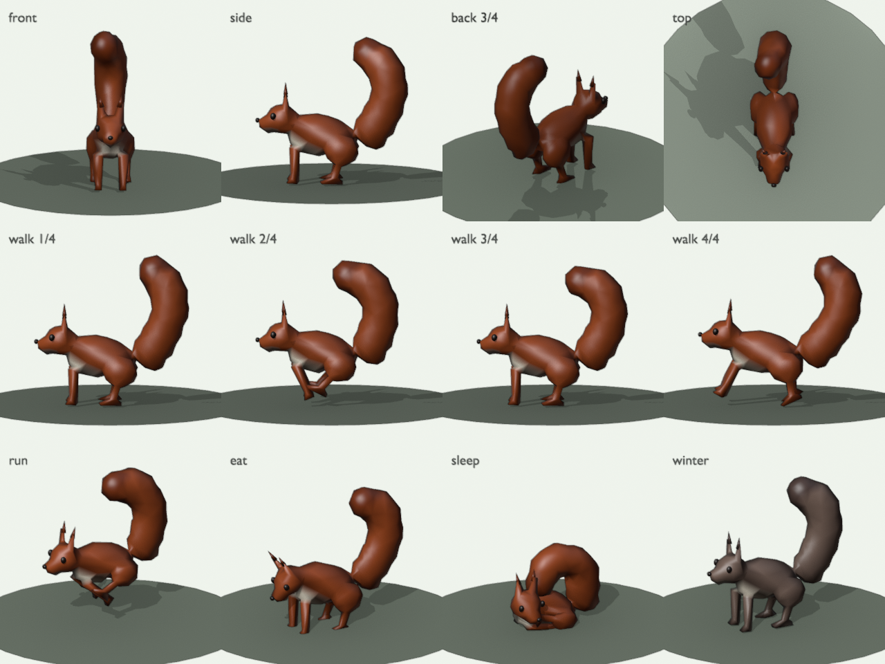
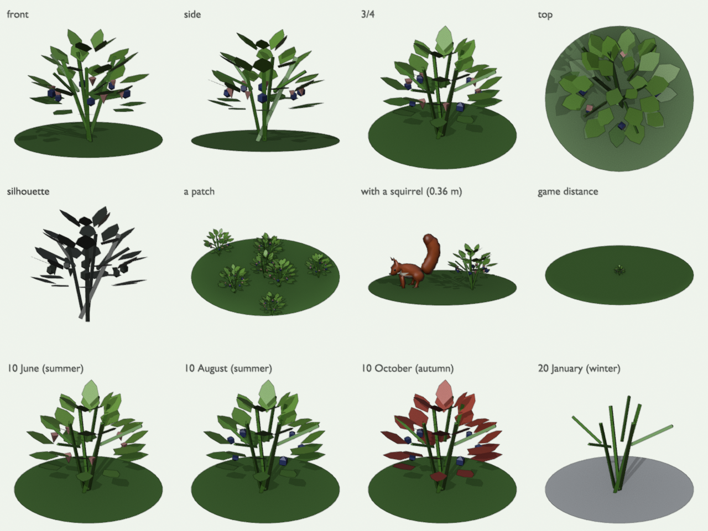

# Animal and plant models

Every animal model in Animundo is made from a **model spec**, one small data file `models/<id>.json`. It lists simple shapes, colours and bones. There's no code to write and no 3D modelling to do. [Blender](https://www.blender.org/download/), which is free, builds the spec into the animated model the game uses, plus a preview sheet for a person to review:

```bash
tools/build_model.sh models/squirrel.json
```

| Output | What it is |
|---|---|
| `assets/animals/<id>.glb` | The model with its animations: `idle`, `walk`, `run`, `eat`, `sleep`, plus `fly` (if it has wings) and `swim` (if it has fins). |
| `models/previews/<id>.png` | The preview sheet: front, side, back and top views, four walk frames, and run, eat and sleep poses. |



Follow the [art guide](../ART.md): real species, real size, flat natural colours, simple shapes.

## The quick way: ask your AI assistant
> I want to add an animal model to the Animundo game. Read `ART.md`, `models/README.md` and the reference model for its body type (the table under [Reference models](#reference-models-where-to-start)) as the example.
> Make a model spec for a **[ANIMAL]**, using its real size in metres, body proportions and colours.
> Build it with `tools/build_model.sh models/<id>.json`, look at the preview sheet, and fix whatever looks wrong
> (floating parts, gaps, wrong proportions, odd poses). Repeat until it looks right.
> Then run `godot --headless --import` and `godot --headless --script tools/check_models.gd`.

For a plant, ask the same with `models/plants/bilberry.json` as the example, and ask for its real year too: when it flowers, fruits and drops its leaves (see [Plants](#plants)).

A person reviews the preview sheet in the pull request before it's merged. To add the whole animal to the game (animal file, text, region), follow **Adding animals** in [CONTRIBUTING.md](../CONTRIBUTING.md).

### Fixing what you see in the preview
| You see | Fix |
|---|---|
| A part floats, or there's a gap | Move it (`at`) so it overlaps its neighbour a little. |
| A foot hangs in the air or sinks | Its lowest point should be at `y = 0`: `at[1]` = half its height. |
| A part stays behind when the leg moves | Its `bone` is wrong: use the leg's bone, not `body`. |
| A row of balls looks like beads | Use more balls that overlap more, with `smooth: true`. |
| A pose looks odd (e.g. legs through the body) | Lower that bone's `swing`, or move the bone's `head` to the joint. |
| Wrong colour in a coat | Change the coat in `animals/<id>.json`; no rebuild is needed for the game. |

## Reference models: where to start

Don't start a new animal from nothing. Copy the existing model closest to it in **body plan and way of moving**, then scale it to the real size and reshape it. A new model is done when it is as good as its reference model in the game's style and a child would recognise the species: simple, never realistic ([ART.md](../ART.md)), so stop at the first round that gets there; compare the two preview sheets side by side. The reference sheet or photos give proportions, colours and markings, not detail the builder can't make.

| New animal | Start from | Change |
|---|---|---|
| Deer: red deer, roe deer, reindeer | `moose` | Lighter body and legs, antler shape; reindeer: heavier coat, both sexes carry antlers |
| Wild boar, other heavy hoofed animals | `moose` | Short legs, low head, big snout |
| Dog family: wolf, arctic fox | `fox` | Size, legs, tail, coat colours |
| Weasel family: pine marten, otter, wolverine, badger | `fox` | Long low body, short legs; otter: swims like the seal |
| Lynx | `fox`, scaled up | Short tail, ear tufts |
| Bears: brown, polar, giant panda, sun bear | `brown_bear` | Size, snout length, ear size, colours. Its eye patches, shoulder band and chest mark are fur-coloured, ready to repaint (panda, sun bear) |
| Hares and rabbits | `mountain_hare` | Ears, coat |
| Squirrels | `squirrel`; gliders: `flying_squirrel` | Size, tail, colours |
| Mice, voles, shrews, lemmings | `vole` | Size, tail, snout |
| Seals | `saimaa_seal` | Size, head, coat pattern |
| Birds of prey, owls | `kestrel` | Size, wing length, beak; owls: big round head, short tail (night animals come later) |
| Songbirds, woodpeckers | `great_tit`, `chaffinch` | Size, beak, colours; woodpecker: stiff tail, chisel beak |
| Ducks, geese, swans | `mallard` | Size, neck length, bill |
| Grouse: ptarmigan, black grouse, capercaillie | `mallard`, reshaped | Small head, short neck, short tail fan, feathered feet; walks more than it flies |
| Wading birds: crane, heron | `mallard`, reshaped | Long legs, long neck and bill |
| Long fish: pike, salmon, trout | `pike` | Body depth, fins, colours |
| Perch-shaped and deep-bodied fish | `perch`, `bream`, `roach` | Body depth, fins, colours |
| Reef fish: clownfish, tangs, parrotfish, butterflyfish | `perch` or `bream`, reshaped | Bright colours and bands; tangs and butterflyfish are deep and flat like a bream. On a reef place's sandy floor among corals |
| Corals, sea fans, sea grass | `examples/plants/` (staghorn coral, brain coral, sea fan) | Plant specs that grow `on: ["seabed"]`, see [Corals and sea grass](#corals-and-sea-grass); build them 1–2 m across, like real reef corals |
| Frogs and toads | `frog` | Skin, colours |
| Lizards | `lizard` | Size, colours |
| Bees, bumblebees, wasps | `bee` | Size, bands |
| Snakes, slow worm, eels | `examples/grass_snake` | Size, head, pattern; eels: `swims`, fins |
| Porpoises and dolphins (up to about 3 m) | `examples/harbour_porpoise` | Size, beak or blunt head, fin shape, pattern |
| Orcas, pilot whales, belugas (up to about 8 m) | `examples/harbour_porpoise`, scaled up | Only in deep-sea places (`terrain.water_level` 24 or more, see CONTRIBUTING) |
| Butterflies and moths | `examples/peacock_butterfly` | Wing shape, colours, eyespots |
| **Not possible yet** | | |
| Great whales (over about 8 m) | none | Even a deep-sea place's water is at most about 55 m deep, and the game hasn't been tested with animals that big |
| Dragonflies | none | Two pairs of wings that beat apart |
| Bats | none | Wings from the arms; night animals come later |

**Adapting a reference in code:** `tools/adapt_model.py` makes a new spec from a reference and a short list of edits, so nobody has to keep 80 positions and sizes consistent by hand. It scales the reference to the real body length, stretches the legs to the real shoulder height, sets the tail's length, then applies edits to whole groups of parts (head, muzzle, ears, leg thickness, paws, body girth, tail width), moving positions and sizes together so parts keep overlapping. It also adds marks (`ear_tufts`, `ruff`, `tail_tip`) and repaints parts. The lynx from the fox: [`examples/edits/lynx.json`](examples/edits/lynx.json).

```bash
python3 tools/adapt_model.py models/fox.json models/examples/edits/lynx.json --out models/lynx.json
tools/build_model.sh models/lynx.json
```

When a new animal is approved, it becomes the reference model for its kind: a steward adds it to this table when merging, and later animals of that kind start from it.

## The spec
Positions are in the game's coordinates, in **metres**, with the animal standing on the ground at `y = 0` and facing forward:
`x` is the animal's **left**, `y` is **up** and `z` is **forward**. Angles are in degrees.

| Field | What it means |
|---|---|
| `id` | The file name, e.g. `squirrel`. |
| `name`, `author` | The animal (common and Latin name) and who made the spec. |
| `gait` | `walk`: the left and right legs alternate (fox, deer). `bound`: they move together (squirrel, hare). |
| `colors` | Named colours, `{"fur": "#b5562a"}`. Parts use these names. |
| `bones` | The skeleton. See below. |
| `parts` | The shapes the body is made of. See below. |

### Bones
Each bone is `{name, head, tail, parent, role}`. `head` is where it bends and `tail` points along it, for example from the hip down to the foot. A bone moves every part attached to it and every bone below it. `parent` is a bone defined earlier, and is `root` (the ground point under the animal) by default.

The `role` decides how the bone moves in each animation:

| Role | Moves like |
|---|---|
| `body` | The trunk, which bends when running. Usually the first bone, with its parent `root`. |
| `head`, `neck` | Looks around, nods while walking, dips to eat and tucks in to sleep. |
| `jaw` | Chews while eating. |
| `leg` | Swings back and forth. `phase` (0–1) says when in the step it swings, e.g. front legs `0` and back legs `0.5`. |
| `tail` | Wags and follows the gait. In a chain of tail bones, raise `phase` a little for each one (0, 0.12, 0.24) so the tail waves. |
| `ear` | Twitches, and flattens back when running and sleeping. |
| `wing` | Flaps in the `fly` animation. |
| `fin` | Swings side to side in the `swim` animation (fish tails). |
| `none` | Doesn't move by itself. |

`swing` (default 1) makes a bone's movement bigger or smaller. `mirror: true` makes a copy for the right side: name the left one with `_l` at the end and the right one is `_r`. In a `walk` gait, the right leg's step is automatically half a step behind the left.

### Parts
Each part is one shape: `{name, shape, size, at, rot, color, bone}`.

| Field | What it means |
|---|---|
| `shape` | `box`, `ball`, `cylinder`, `cone` (pointed at the top), or `taper` (a cylinder narrower at the top; `top` sets how much, 0–1). |
| `size` | `[width, height, length]` in metres, before rotating. |
| `at` | Where its middle is. |
| `rot` | `[pitch, yaw, roll]` in degrees. Pitch tips the front down, yaw turns it left and roll leans it to the right. `[180, 0, 0]` turns a cone upside down. |
| `color` | One of the names in `colors`. |
| `bone` | The bone it moves with. |
| `mirror` | `true` makes a copy for the right side (name ends in `_l`). If the bone ends in `_l`, the copy uses the `_r` bone. |
| `separate` | `true` keeps the part as its own crisp piece instead of melting it into the body. Use it for eyes, nose, ears and tufts. Parts thinner than two voxels are kept separate anyway. |
| `detail` | How round balls and cylinders are (1 is the default). It only matters for `separate` parts; the body is rebuilt from the melted shape. |

### How the body is made
The builder doesn't use the shapes as they are. It **melts them into one continuous skin**, like clay, smooths it, and reduces it to the triangle budget. Each spot on the skin takes its colour and bone from the nearest part, and the bones' pull is blended across the joints so the skin bends instead of tearing. So write the spec as if you were sculpting with lumps of clay: overlapping shapes become one smooth body.

The settings are tuned for the whole game (see [decision 0012](../docs/decisions/0012-smooth-skin-models.md)). Change them only with a reason, in a `skin` entry in the spec:

| Setting | Default | What it does |
|---|---|---|
| `triangles` | `1000` | Triangle budget for the whole animal. See the budgets in [ART.md](../ART.md#4-size-on-screen-and-budgets). |
| `shading` | `"smooth"` | Soft shading. `"flat"` gives facets, but costs about 5 times more vertices and twice the download. |
| `voxel` | `1/70` | How finely the parts are melted, as a part of the body length. Smaller keeps thinner legs. |
| `smooth` | `4` | Smoothing passes on the melted body. It costs nothing in size. |
| `blend` | `3` | How far a joint's bend spreads along the skin. |
| `keep` | `2` | Parts thinner than this many voxels stay separate. |

`"skin": false` builds the old way, from loose parts. Don't use it for new animals.

**Colours are stored on the vertices,** and the whole animal is one material, so the phone draws it in one call ([decision 0013](../docs/decisions/0013-one-material-per-animal.md)). Where two colours meet, they blend softly across one row of triangles. The colour names and values go into the model file, and that's how the game finds a colour to swap for a seasonal coat.

**Sleeping:** an animal lies down on its belly with its legs folded under it: the body drops to 80% of its hip height (the height of its leg bones' heads), front legs fold back under the chest and hind legs forward under the belly. Override it in the spec with `"sleep_drop"` (share of the hip height, default 0.8) and `"sleep_legs"` (degrees for the front and hind legs, default `[83, -83]`). Birds keep their feet under them instead. Animals that sleep curled up set `"sleep_pose": "curl"`: the head turns back along the flank, nose tucked, and the tail wraps around the same side toward the nose (a fox). An upright tail folds forward over the back instead with `"sleep_tail": "over"` (a squirrel).

### Rules for a good spec
These came from building the squirrel. Each one fixes something that looked wrong in a preview.

- **Overlap generously.** Melted parts need to overlap by about a third of their size, or the skin pinches between them.
- **Chains of balls overlap by half.** A tail or neck made of balls looks like beads unless each ball overlaps the next by at least half its length. Use 5–7 balls for a bushy tail.
- **Separate parts sink in.** Eyes, ears and tufts must reach into what they sit on by a third of their own size. Smoothing can shrink the body slightly, and a part that only touches it will float.
- **Ears are tapers, not cones.** A cone's tip disappears from a few metres away. Use `taper` with `top` about 0.4.
- **Mark the details.** Set `separate: true` on eyes, nose, ears and tufts so they stay crisp.
- **Thin legs stay thick enough.** A leg thinner than about 1/30 of the body length melts away. Make it a little thicker than real if needed.

- **Separate parts share the triangle budget.** Eyes, fins, spots and bars come out of `triangles` too, and the melted body never gets fewer than 200. Use `detail` 0.4–0.7 on separate parts, or the total goes over budget and the body turns coarse.
- **Split melted parts at bone boundaries.** Each spot on the skin takes the bone of the nearest part, so a long back or belly part that spans two bones leaves its rear skin stuck to the front bone.

### Birds
The kestrel ([kestrel.json](kestrel.json)) is the example.

- **Model the wings spread** straight out sideways, as in flight, with each `wing` bone's head at the shoulder and its tail toward the wing tip. Use the real wingspan.
- **On the ground the builder folds them:** `fold` (degrees, per wing bone) turns the wing on its side and sweeps it back, and `fold_length` (default 0.6) shortens it, like a wing folding at the wrist. The default fold doesn't suit every bird; the kestrel uses `"fold": [-111, 18, -80.8]`. Check the folded wing from the front and top: it should lie flat on the flank, with the tips over the tail.
- **Keep wings narrow:** folding shortens a wing but doesn't narrow it, so a broad wing folds into a block.
- **Model the bird perched,** body tipped up as it really sits. `fly_pitch` (degrees, default 50) is how far the body tips forward in flight, from its perched angle: set it to about the perched tilt so the flying body ends level. More is not better: past that the bird flies nose-down. The head and tail stay level and the legs tuck back. The preview sheet draws every clip, fly too, standing on the ground; in the game the bird flies at height, so judge the fly frame by its wings and body angle, not by where it is.
- **Thin legs, wings and tail feathers** stay separate rigid pieces automatically, which keeps them crisp.

### Fish
The perch ([perch.json](perch.json)) is the example.

- **Spine chain:** a `body` bone from the snout backwards, then three `fin` bones with `phase` 0, 0.12 and 0.24. The tail fin rides the last one. This gives a travelling swim wave. Lower `swing` (0.6–0.8) for long fish like the pike.
- **Fins are flat cylinders,** not balls: `"shape": "cylinder"`, `"rot": [pitch, 0, 90]`, size [height, thickness, length], part-buried in the body. Make dorsal fins stand well clear of the back, or they read as bumps.
- **Bars and spots are separate parts:** thin rings a few millimetres wider than the body, or small flattened balls sunk a third into it. Melted into the body they come out as jagged shards.
- **In the animal file,** map only `"idle": "idle"` and `"fly": "swim"`. A fish "flies" in water, and the generated sleep and eat clips tip a fish over.

### Insects
The bumblebee ([bee.json](bee.json)) is the example.

- **Build it at real size,** in metres: a bumblebee queen is about 0.02 m. The builder scales its melting resolution and preview camera to the animal's size. In the game, insects live in the **small world** and are shown at 5 times real size: set the animal file's `length` to 5 times the printed length ([ART.md](../ART.md#two-scales-the-world-and-the-small-world)).
- **`"wingbeat": "buzz"`** makes the wings flip every frame in flight, which reads as the blur of a real insect's wings. Model the wings spread out, one `wing` bone per side can carry both wings.
- **Insects fly level:** `"fly_pitch": 0`. `"fly_legs"` (degrees) is how far the legs swing back in flight; a bee's dangle at about 25.
- **Wings rest flat over the back:** a `fold` that only sweeps them back, such as `[0, 84, 4]`, with `"fold_length": 1.0` (insect wings don't fold).
- **Colour bands are their own overlapping balls** (a bee's yellow collar, yellow band and white tail); the skin blends their colours softly.
- **Six legs** are three mirrored `leg` bones; phases 0, 0.5 and 0 (front, middle, back) give the insect's tripod walk.
- **Butterflies and moths flap** instead of buzzing: leave `wingbeat` out. Make the wings broad flat balls on one `wing` bone per side, and fold them closed upright over the back at rest with `"fold": [0, 0, -80]` and `"fold_length": 1.0`. Eyespots and bands are thin separate balls on the wings. Example: [examples/peacock_butterfly.json](examples/peacock_butterfly.json).

### Bodies that wave: snakes, eels, whales and dolphins
An animal without legs moves by waving its body. Make the body a chain of `spine` bones from the neck to the tail tip, each parented to the one before, with `phase` growing toward the tail (about 0.15 to 0.2 per bone), so a wave runs from head to tail. One overlapping ball per bone makes the body.

- **`"undulate": "side"`** (the default) waves left and right: snakes, slow worms, eels. Asleep, the chain curls into a coil. Example: [examples/grass_snake.json](examples/grass_snake.json).
- **`"undulate": "up"`** beats up and down: whales, dolphins, porpoises, whose tail ends in a flat, horizontal fluke (a wide, thin ball on the last bone). Flippers are `fin` bones; the dorsal fin is a `taper`. Raise `swing` a little along the chain so the tail beats more than the chest. Example: [examples/harbour_porpoise.json](examples/harbour_porpoise.json).
- **`"swims": true`** gives the model a `swim` clip even without fins (a whale, a swimming grass snake).
- **The sea:** every place already ends in water at its edge (`terrain.edge`: `"lake"`), and its `lakes` can be large. Most places' water is at most about 8 m deep, so swimmers up to about 3 m long fit there: porpoises and most dolphins. A deep-sea place (`terrain.height` 64, `terrain.water_level` 24 or more) has room for orcas and other whales up to about 8 m; the great whales are still bigger than the game has been tested with.

The `examples/` models are body-plan examples, not animals in the game: start a new kind of animal from one of them, then it becomes the reference model for its kind. They are built and checked in CI like the rest.

### Checklist for a good model
- **Real size.** Look the animal up. The build prints its length and height.
- **No gaps.** Parts on the same body overlap a little. Legs reach the ground (`y = 0`), and nothing floats.
- **Recognisable from far away.** The game camera is a few metres back, so silhouette and colour matter more than detail.
- **Bones where the joints are.** The `head` of a leg bone sits at the shoulder or hip, not at the foot.
- **Within budget.** The build prints the triangles; [ART.md](../ART.md#4-size-on-screen-and-budgets) has the limits.

## Seasonal coats
Some animals change colour with the seasons. A red squirrel turns greyer in winter, and a mountain hare turns white. A coat lists only the spec colours that change. It goes in the **animal file**, `animals/<id>.json`, under `model`:

```json
"coats": {"winter": {"fur": "#8a7266", "fur_dark": "#5e4a44"}}
```

Seasons are `spring`, `summer`, `autumn` and `winter`. They follow the region's real calendar. A coat grows in over the first three weeks of its season and fades out over the first three weeks of the next season, like a real moult. The preview sheet shows every coat, and the build stops with an error if a coat names a colour the spec doesn't have. Animals that keep the same coat all year leave `coats` out.

To see a coat in the game, add a date to the URL, e.g. `&date=2027-01-20`.

## Seasonal parts
Some animals grow or lose parts with the seasons: a bull moose drops its antlers in midwinter and grows new ones from spring. Put such parts on their own bone, rooted where they grow from (the moose's `antlers` bone sits on top of the skull, with every antler part on it), and list that bone's size per season in the **animal file**, under `model`:

```json
"seasonal_parts": {"antlers": {"winter": 0.0, "spring": 0.5, "summer": 1.0, "autumn": 1.0}}
```

Sizes go from 0 (gone, tucked inside its root) to 1 (full size); seasons left out are full size. In the game a part **grows** slowly over a season's first three weeks, but **drops** all at once, as real antlers fall off. The preview sheet shows one tile per season. The build stops if a seasonal part isn't a bone in the spec.

## Using the model in the game
After building, set the `model` entry in `animals/<id>.json`: `"file": "res://assets/animals/<id>.glb"`, `"yaw": 0.0`, the `length` the build printed (so the model keeps its real size), and the clips by name, e.g. `"anims": {"idle": "idle", "walk": "walk", "run": "run", "eat": "eat", "sleep": "sleep"}`.

## Trees
Trees are made of blocks, like the land, so they're built differently from animals and plants. A tree spec, `models/trees/<id>.json`, says how tall the trunk is and what shape the crown has; `tools/build_model.sh models/trees/<id>.json` turns it into block templates (`assets/trees/<id>.json`, three heights, which the game stamps into the land) and a preview sheet (`models/trees/previews/<id>.png`, with a moose for scale) of exactly those blocks. A place uses the tree with `trees.mix[].shape` set to the spec's id; up to six spec trees per place, next to the game's own spruce, pine, birch, rowan and round trees.

| Key | What it is |
|---|---|
| `trunk.height` | `[lowest, highest]` trunk in blocks (metres) |
| `trunk.girth` | 1, 2 or 3 blocks wide (a baobab is 3) |
| `trunk.lean` | blocks the top leans over (palms) |
| `trunk.roots` | stilt roots, `{count, spread, height}`: they arch out from the trunk and drop into the water (mangroves) |
| `crown.shape` | `round`, `cone`, `column`, `umbrella` or `palm` |
| `crown.radius`, `squash`, `height` | the crown's size; `squash` flattens a round crown |
| `crown.thickness`, `branches` | an umbrella's flat crown and its forked branches |
| `crown.fronds`, `length`, `droop` | a palm's leaves |
| `colors` | `trunk`, `leaves`, and `autumn` for trees that drop their leaves (bare in winter) |
| `on` | the ground it grows on: `grass`, `rock`, `sand`, or `water` for shallow water at most 2 blocks deep (default grass) |

A tree must fit the game: at most 18 blocks tall and 8 blocks from the trunk to the crown's edge. Like every plant it has a `latin` name, a `taxon` (`tools/taxon.py`), `sources` and a field guide page in `locale/<lang>/plants.json`.

| Trees | Crown | Start from |
|---|---|---|
| Firs, spruces, cedars | `cone` | the game's spruce |
| Oaks, maples, beeches, limes; rainforest giants (girth 2, tall) | `round` | `examples/trees/baobab.json` with girth 1 or 2 |
| Cypresses, poplars | `column` | `examples/trees/italian_cypress.json` |
| Acacias, stone pines | `umbrella` | `examples/trees/umbrella_thorn.json` |
| Palms | `palm` | `examples/trees/coconut_palm.json` |
| Baobabs | `round`, girth 3 | `examples/trees/baobab.json` |
| Mangroves | `round`, stilt roots, `on: ["water", "sand"]` | `examples/trees/red_mangrove.json` |
| **Not possible yet:** cacti, bamboo groves, trees taller than 18 m | | |

## Plants
Plants are made the same way, from a spec in `models/plants/<id>.json`, and built with the same command:

```bash
tools/build_model.sh models/plants/bilberry.json
```

| Output | What it is |
|---|---|
| `assets/plants/<id>.glb` | One mesh with its colours in the vertices. The game draws thousands of copies at once, and they sway in the wind. |
| `models/previews/plants/<id>.png` | The preview sheet: front, side, 3/4 and top views, the silhouette, a patch, a red squirrel next to it for size, how big it looks from the game camera, and a row showing it through the year in the starter region. |



A plant spec is like an animal spec without bones. It has `id`, `name`, `author`, `colors` and `parts`, plus `latin` (the scientific name), `year` (leaves, flowers and fruit) and `sources`. The rules for these, and what reviewers check, are in [CONTRIBUTING.md](../CONTRIBUTING.md#adding-plants). It also has:

| Field | What it means |
|---|---|
| `kind` | `ground` for small ground cover drawn thousands of times (under 50 faces), or `bush` (under 300 faces). The build stops if the plant is over budget. |
| `seasons` | Optional colour changes by season, like an animal's coat: `{"autumn": {"leaf": "#c4493a"}}`. They blend in over three weeks, by the region's own season dates. |

Parts take the same fields as an animal's (no `bone`), plus:

| Field | What it means |
|---|---|
| `shape` | Also `leaf`: a flat leaf, pointed at the front (+z), with one face. `size` is `[width, unused, length]`. With `detail` 0.5 or less it's a diamond of 2 triangles instead of 4, and a `ball` with `detail` 0.3 or less has 8 triangles instead of 16: use these for plants that grow everywhere (see the budgets in ART.md). |
| `around` | Makes this many copies spaced evenly around the stem (the upright line through `pivot`, `[x, z]`, default `[0, 0]`). Put the first copy on the front (+z). `turn` (degrees) turns the whole ring. |
| `jitter` | 0–1: copies in a ring differ a little in angle, tilt and size, so the plant looks grown, not machined. The same spec always builds the same plant. |
| `seed` | Optional name: rings with the same `seed`, `around` and `jitter` get the same random turns, so one part can sit on another, like heather's flower spikes on its shoots. |
| `show` | Optional: the part is there only part of the year, `{"from": "summer+50", "until": "autumn+20"}`: from 50 days after summer starts until 20 days after autumn starts. Use it for flowers, berries and leaves that fall. The dates are relative to each region's own `seasons`, so one bilberry is right in southern Finland and in Lapland. |
| `nectar` | Optional, for flowers bees drink from: `true` makes the part a flower a bumblebee can drink nectar from while it shows. If the flowers stay on after the nectar is gone (heather's dry brown spikes), give the nectar its own dates, `{"from": "summer+55", "until": "autumn"}`. The game puts the flower at the part's height and lets the bee drink anywhere round its ring. |

**Look up the plant's year** (when it flowers, fruits, turns colour and drops its leaves) in the same sources as its looks, then check the season row of the preview sheet. The top two rows show every part at once, flowers and berries together, so you can check the shapes.

To grow it in a region, add it to the region file's `ground_cover.plants` (see [CONTRIBUTING.md](../CONTRIBUTING.md)) and run `godot --headless --import` and `godot --headless --script tools/check_models.gd`. The game reads the spec (`scripts/plant_model.gd`) to recolour the plant and leave out parts for the season. It finds parts by their order in the spec, so rebuild after adding, removing or reordering parts.

### Corals and sea grass
Corals are animals, but in the game they are scenery on the sea floor, built like plants: a plant spec with `"kind": "bush"`, evergreen, and a region uses it in `ground_cover.plants` with `"on": ["seabed"]`, so it grows under the water (on a sandy floor with `terrain.seabed: "sand"`). Keep them simple: a branching coral is a few cones from a base, a brain coral a squashed ball with a ridge or two, a sea fan a flat upright ball on a stalk. Examples: [examples/plants/](examples/plants/) (staghorn coral, brain coral, sea fan), previews in `examples/previews/`.
